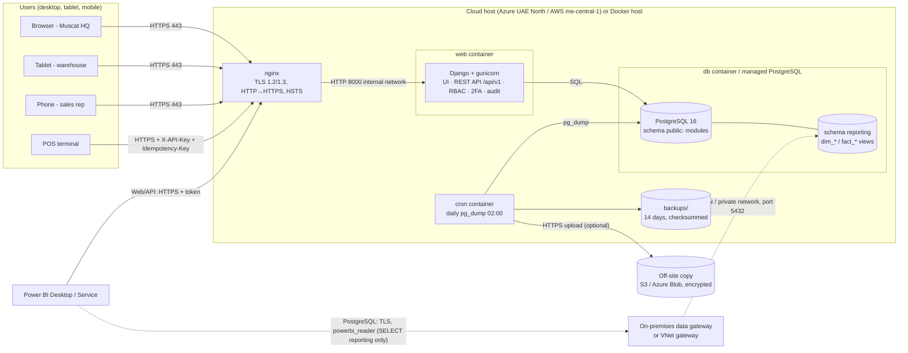

# Deployment / Architecture Diagram

Report reference: §4.4.1 (cloud-based system architecture: web UI, cloud backend with RDBMS, service layer,
Power BI), §4.4.4 (network: encrypted connections, VPN), §4.6 (secure hosting, encryption, RBAC),
§5.2.2 (backup).

| Component | Technology | Security / reliability |
|---|---|---|
| Reverse proxy | nginx 1.27 | TLS termination, HTTP→HTTPS redirect, HSTS, security headers, re-resolves the app container |
| Application | Django 5.2, DRF, gunicorn (3 workers) | RBAC on every page and endpoint, TOTP 2FA, axes lockout, CSRF, audit log, health check |
| Database | PostgreSQL 16 | SSL on, field encryption for personal data, read-only `powerbi_reader`, encrypted disks in the cloud |
| Analytics | Power BI (Import + DirectQuery) | Gateway inside the private network, TLS to the database, token-based API alternative |
| Backup | cron + pg_dump | Daily, checksummed, optional AES-256 and off-site copy; RPO 24 h, RTO 4 h |
| Monitoring | Monitoring middleware + `/health/` | Response time, errors, availability, last backup – in-app and in Power BI |
