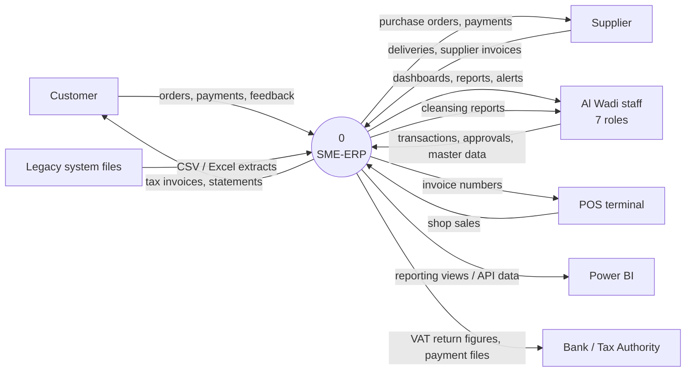
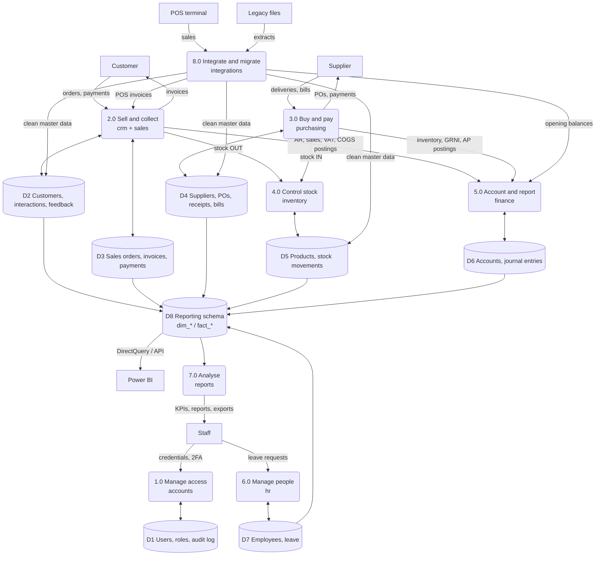

# Data Flow Diagrams

Report reference: §3.6 (functional models: data flow diagrams).
Notation: rectangles = external entities, rounded boxes = processes, cylinders = data stores.

## DFD Level 0 (context diagram)

## DFD Level 1

