# Entity Relationship Diagram

Report reference: §4.4.2 (database requirements: tables per module, foreign keys, indexes).
Money columns are `numeric(14,3)` (OMR), quantities `numeric(12,3)`. All tables live in PostgreSQL schema
`public`; the read-only star schema for Power BI is described in [../powerbi/model.md](../powerbi/model.md).

```mermaid
erDiagram
    HR_DEPARTMENT ||--o{ ACCOUNTS_USER : "department"
    HR_DEPARTMENT ||--o{ HR_EMPLOYEE : employs
    ACCOUNTS_USER |o--o| HR_EMPLOYEE : "is"
    HR_EMPLOYEE ||--o{ HR_LEAVEREQUEST : requests
    ACCOUNTS_USER ||--o{ ACCOUNTS_AUDITLOG : performs

    INVENTORY_CATEGORY ||--o{ INVENTORY_PRODUCT : groups
    INVENTORY_PRODUCT ||--o{ INVENTORY_STOCKMOVEMENT : moves
    INVENTORY_WAREHOUSE ||--o{ INVENTORY_STOCKMOVEMENT : holds

    PURCHASING_SUPPLIER ||--o{ PURCHASING_PURCHASEORDER : "ordered from"
    INVENTORY_WAREHOUSE ||--o{ PURCHASING_PURCHASEORDER : "delivered to"
    PURCHASING_PURCHASEORDER ||--|{ PURCHASING_PURCHASEORDERLINE : contains
    INVENTORY_PRODUCT ||--o{ PURCHASING_PURCHASEORDERLINE : ordered
    PURCHASING_PURCHASEORDER ||--o{ PURCHASING_GOODSRECEIPT : "received by"
    PURCHASING_GOODSRECEIPT ||--|{ PURCHASING_GOODSRECEIPTLINE : contains
    PURCHASING_PURCHASEORDERLINE ||--o{ PURCHASING_GOODSRECEIPTLINE : fulfils
    PURCHASING_PURCHASEORDER ||--o{ PURCHASING_SUPPLIERBILL : "billed by"
    PURCHASING_SUPPLIERBILL ||--o{ PURCHASING_SUPPLIERPAYMENT : "paid by"

    CRM_CUSTOMER ||--o{ CRM_CONTACT : has
    CRM_CUSTOMER ||--o{ CRM_INTERACTION : logs
    CRM_CUSTOMER ||--o{ CRM_FEEDBACK : gives
    SALES_INVOICE |o--o{ CRM_FEEDBACK : "about"
    CRM_CUSTOMER ||--o{ SALES_SALESORDER : places
    SALES_SALESORDER ||--|{ SALES_SALESORDERLINE : contains
    SALES_SALESORDER |o--o{ SALES_INVOICE : "invoiced as"
    CRM_CUSTOMER ||--o{ SALES_INVOICE : billed
    INVENTORY_WAREHOUSE ||--o{ SALES_INVOICE : "ships from"
    SALES_INVOICE ||--|{ SALES_INVOICELINE : contains
    INVENTORY_PRODUCT ||--o{ SALES_INVOICELINE : sold
    SALES_INVOICE ||--o{ SALES_PAYMENT : "paid by"
    SALES_INVOICE ||--o{ SALES_CREDITNOTE : "credited by"
    SALES_CREDITNOTE ||--|{ SALES_CREDITNOTELINE : contains
    SALES_INVOICELINE ||--o{ SALES_CREDITNOTELINE : returns

    FINANCE_ACCOUNT ||--o{ FINANCE_JOURNALLINE : "posted to"
    FINANCE_JOURNALENTRY ||--|{ FINANCE_JOURNALLINE : contains
    FINANCE_ACCOUNT ||--o{ FINANCE_EXPENSE : "expense account"
    FINANCE_JOURNALENTRY |o--o| FINANCE_EXPENSE : posts
    FINANCE_JOURNALENTRY |o--o{ SALES_INVOICE : posts
    FINANCE_JOURNALENTRY |o--o{ PURCHASING_SUPPLIERBILL : posts

    INTEGRATIONS_APIKEY ||--o{ INTEGRATIONS_IDEMPOTENCYRECORD : uses
    INTEGRATIONS_IDEMPOTENCYRECORD |o--o| SALES_INVOICE : created
    ACCOUNTS_USER ||--o{ INTEGRATIONS_IMPORTJOB : runs

    INVENTORY_PRODUCT {
        bigint id PK
        varchar sku UK
        varchar name
        bigint category_id FK
        varchar unit
        numeric cost_price "weighted average"
        numeric sale_price
        numeric vat_rate "5.00"
        numeric reorder_level
    }
    INVENTORY_STOCKMOVEMENT {
        bigint id PK
        bigint product_id FK
        bigint warehouse_id FK
        varchar movement_type "IN OUT TRANSFER ADJUST"
        numeric quantity "signed delta"
        numeric unit_cost
        varchar reference_type "GRN INV CN ADJ TRF OPEN"
        bigint reference_id
        timestamptz movement_date
    }
    SALES_INVOICE {
        bigint id PK
        varchar number UK
        bigint customer_id FK
        date invoice_date
        date due_date
        varchar status "POSTED PARTIAL PAID CANCELLED"
        varchar source "MANUAL SO POS IMPORT"
        numeric subtotal
        numeric vat_amount
        numeric total
        numeric amount_paid
        numeric amount_credited
        numeric cost_total
    }
    SALES_INVOICELINE {
        bigint id PK
        bigint invoice_id FK
        bigint product_id FK
        numeric quantity
        numeric unit_price
        numeric discount_pct
        numeric line_subtotal
        numeric line_vat
        numeric unit_cost
    }
    FINANCE_JOURNALENTRY {
        bigint id PK
        varchar number UK
        date entry_date
        varchar source_type "INV PAY CN GRN BILL SPAY EXP ADJ OPEN MAN"
        bigint source_id
    }
    FINANCE_JOURNALLINE {
        bigint id PK
        bigint entry_id FK
        bigint account_id FK
        numeric debit "CHECK >= 0"
        numeric credit "CHECK >= 0, one side only"
    }
    CRM_CUSTOMER {
        bigint id PK
        varchar code UK
        varchar name
        varchar customer_type
        varchar city
        numeric credit_limit
        smallint payment_terms_days
    }
    CRM_FEEDBACK {
        bigint id PK
        bigint customer_id FK
        smallint score "CHECK 1..5"
        date feedback_date
    }
    HR_EMPLOYEE {
        bigint id PK
        varchar employee_no UK
        bigint department_id FK
        numeric basic_salary
        text national_id "Fernet encrypted"
        text bank_iban "Fernet encrypted"
    }
    ACCOUNTS_AUDITLOG {
        bigint id PK
        bigint user_id FK
        varchar action
        varchar model
        varchar object_id
        jsonb changes
        inet ip_address
        timestamptz timestamp
    }
```

Supporting tables not drawn: `core_sequence` (document numbers), `core_systemfeedback` (user evaluation),
`monitoring_requestmetric`, `monitoring_healthprobe`, `feasibility_feasibilitystudy`, `integrations_importjob`,
Django auth/session tables, `otp_totp_totpdevice` (2FA) and `axes_accessattempt` (lockout).
