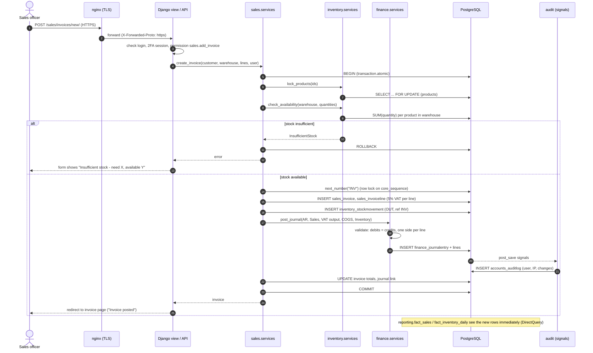

# Sequence Diagram – Invoice Posting

Report reference: §3.6 (behavioural models: sequence diagrams). Shows `sales.services.create_invoice`, which is
called by the web UI, the REST API and the POS integration alike.

