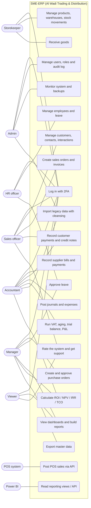

# Use Case Diagram

Report reference: §3.6 (functional models: use case diagrams). Mermaid has no UML use-case notation, so actors
are drawn as stadium nodes and use cases as rounded boxes inside the system boundary.

| Actor | Main goals |
|---|---|
| Admin | Users and roles, audit log, monitoring and backups, data migration (has every permission) |
| Manager | Approve purchases and leave, follow KPIs, feasibility |
| Accountant | Bills, payments, journals, expenses, VAT and financial reports |
| Sales officer | Customers and CRM, orders, invoices, receipts |
| Storekeeper | Stock, transfers, adjustments, goods receipts |
| HR officer | Employees, departments, leave |
| Viewer | Read-only business data and dashboards |
| POS system | Sends completed shop sales (API key + idempotency key) |
| Power BI | Reads the `reporting` schema (powerbi_reader) or the reporting API (token) |
