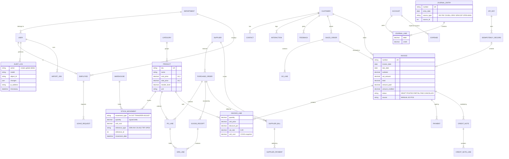
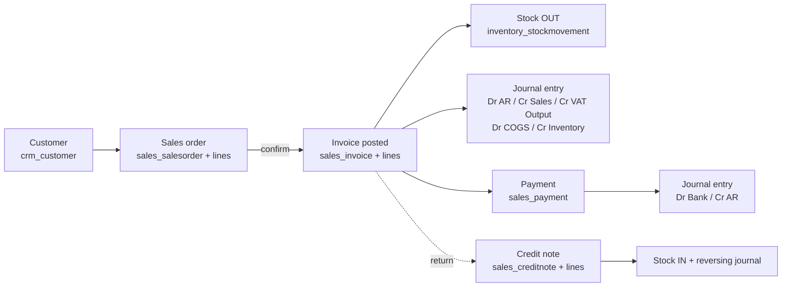
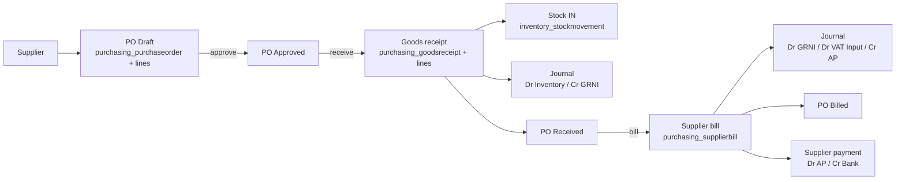

# SME-ERP — Implementation Plan

Case company: **Al Wadi Trading & Distribution LLC** (Muscat, Oman). Currency OMR (3 dp), VAT 5 %,
timezone Asia/Muscat, weekend Friday–Saturday.

This plan turns report Chapters 3–5 into a buildable system. Report trace: 4.1 (modular cloud ERP),
4.4.1 (web UI, RDBMS, RESTful service layer, Power BI), 4.6 (encryption, RBAC), 5.1.3 (data conversion
and cleansing), 5.2.2 (backup/DR), 5.2.3 (performance monitoring), 5.1.2 (unit/integration/UAT testing).

## 1. Folder structure

```text
sme-erp/
├── config/                    Django project
│   ├── settings/{base,dev,prod,test}.py
│   ├── urls.py  api_urls.py  wsgi.py  asgi.py
├── core/                      shared: base models, mixins, dashboard, health check, money helpers
├── accounts/                  User (email login), roles, 2FA, AuditLog, user admin UI
├── inventory/                 Category, Product, Warehouse, StockMovement
├── purchasing/                Supplier, PurchaseOrder(+lines), GoodsReceipt(+lines), SupplierBill, SupplierPayment
├── sales/                     SalesOrder(+lines), Invoice(+lines), Payment, CreditNote(+lines)
├── crm/                       Customer, Contact, Interaction, Feedback, Customer 360
├── finance/                   Account (CoA), JournalEntry(+lines), Expense, VAT/aging/TB/P&L reports
├── hr/                        Department, Employee, LeaveRequest
├── reports/                   `reporting` schema views, Power BI API, dashboard KPIs, report builder
├── integrations/              import wizard + cleansing, exports, POS API (API key + idempotency)
├── monitoring/                request metrics middleware, system health page, system-metrics API
├── feasibility/               ROI / NPV / IRR / payback / TCO calculator
├── templates/  static/        Bootstrap 5 layout, HTMX, Chart.js
├── docker/                    web (Dockerfile, start.sh), nginx (conf), backup (cron image)
├── scripts/                   gen_cert.sh, backup.sh, restore.sh, wait_for_db.py
├── sample_data/legacy/        dirty CSV/XLSX files for the migration demo
├── loadtest/locustfile.py
├── docs/                      plan, requirements, diagrams, testing, powerbi, manuals, deployment
├── docker-compose.yml  Makefile  make.ps1  requirements.txt  pytest.ini  .env.example
```

Every business app follows the same layout: `models.py`, `services.py` (all business logic),
`serializers.py`, `api.py` (DRF viewsets), `views.py` (server-rendered UI), `forms.py`, `filters.py`,
`admin.py`, `urls.py`, `tests/`.

## 2. ERD



Design notes:
- **Stock is never stored**. Current stock is `SUM(stock_movement.quantity)` per product per warehouse
  (signed deltas). A transfer writes two rows (−source, +destination) with the same reference.
- **Money** is always `DecimalField(14, 3)`; quantities `DecimalField(12, 3)`.
- `reporting` schema views (`dim_*`, `fact_*`) sit on top of these tables and are the only objects
  the `powerbi_reader` PostgreSQL role can read.

## 3. REST endpoints (`/api/v1/`)

Auth: session (UI) or token (`Authorization: Token …`). Every endpoint uses Django model permissions,
so access follows the role groups. Docs: `/api/docs/` (Swagger) and `/api/schema/`.

| Module | Endpoint | Methods | Roles (write / read-only) |
|---|---|---|---|
| auth | `auth/token/` (email + password + OTP) | POST | any active user |
| accounts | `accounts/users/`, `accounts/audit-logs/` | CRUD / GET | Admin / Admin |
| inventory | `inventory/categories/`, `products/`, `warehouses/` | CRUD | Admin, Manager, Storekeeper / all |
| inventory | `inventory/stock-movements/` (+ `stock-levels/`, `low-stock/`) | GET, POST | Admin, Storekeeper / all |
| purchasing | `purchasing/suppliers/`, `purchase-orders/` (+`approve`, `receive`) | CRUD | Admin, Manager, Storekeeper (receive) / Accountant, Viewer |
| purchasing | `purchasing/goods-receipts/`, `bills/`, `supplier-payments/` | GET, POST | Admin, Accountant, Storekeeper (GRN) / Manager, Viewer |
| sales | `sales/orders/` (+`confirm`, `invoice`) | CRUD | Admin, Manager, SalesOfficer / Accountant, Viewer |
| sales | `sales/invoices/` (+`post`), `payments/`, `credit-notes/` | GET, POST | Admin, Accountant, SalesOfficer / Manager, Viewer |
| crm | `crm/customers/` (+`360`), `contacts/`, `interactions/`, `feedback/` | CRUD | Admin, Manager, SalesOfficer / Accountant, Viewer |
| finance | `finance/accounts/`, `journal-entries/`, `expenses/` | CRUD | Admin, Accountant / Manager, Viewer |
| finance | `finance/reports/{trial-balance,profit-loss,vat-return,ar-aging,ap-aging}/` | GET | Admin, Accountant, Manager, Viewer |
| hr | `hr/departments/`, `employees/`, `leave-requests/` (+`approve`, `reject`) | CRUD | Admin, HROfficer, Manager (approve) / Viewer |
| reports | `reports/dim-*/`, `reports/fact-*/` (date filters, pagination) | GET | Admin, Manager, Accountant, Viewer, Power BI token |
| reports | `reports/kpis/`, `reports/system-metrics/` | GET | same as above / Admin |
| integrations | `integrations/export/{entity}/?format=csv\|xlsx` | GET | Admin, Manager, Accountant |
| integrations | `integrations/pos/sales/` (X-API-Key + Idempotency-Key) | POST | POS API key |
| feasibility | `feasibility/calculate/` | POST | Admin, Manager, Accountant |

## 4. Business flows

### Order-to-cash

Invoice posting is one `transaction.atomic()` block: lock product rows, check stock in the warehouse
(block when insufficient), write invoice, stock movements and journal entry together.

### Procure-to-pay


## 5. Security design
- Custom email-login user; 7 role groups created by a data migration and re-synced after every migrate.
- TOTP 2FA (django-otp) mandatory for Admin and Accountant; optional for others.
- django-axes: lock after 5 failures; passwords ≥ 12 characters; 30-minute idle session timeout.
- AuditLog written by signals for every business model create/update/delete.
- In transit: nginx TLS (HTTP→HTTPS redirect, HSTS); PostgreSQL SSL for Power BI connections.
- At rest: Fernet field encryption for sensitive HR fields (national ID, IBAN), encrypted backups
  (AES-256) and encrypted cloud disks (documented in deployment guides).

## 6. Risks and ambiguities (and the decisions taken)
| # | Item | Decision |
|---|---|---|
| 1 | Python 3.12 and `make` not on the Windows host | Everything runs in Docker (python:3.12-slim); `make.ps1` mirrors the Makefile |
| 2 | Department is used by accounts (Phase 2) and HR (Phase 3) | `hr.Department` is created in Phase 2; User has a nullable FK |
| 3 | "Opening balances" import target | GL account opening balances, posted as one balanced journal against Opening Balance Equity |
| 4 | PostgreSQL has no native TDE | Field-level encryption plus encrypted volumes/backups; documented |
| 5 | Permissions don't exist inside the first data migration | Migration calls `create_permissions` then a shared role-sync service, also run on `post_migrate` |
| 6 | fact_inventory_daily cost on DirectQuery | Plain view with window sum; can switch to a materialized view if slow |
| 7 | Seeding 8,000 invoices through services is slow | Seed uses the real services (data is consistent) with audit logging switched off |
| 8 | Partial goods receipts | Allowed; PO becomes Received when every line is fully received |
