# Power BI Data Model (star schema)

All tables come from PostgreSQL schema `reporting` (or the matching API datasets). Dimensions are on the
"one" side, facts on the "many" side; every relationship is **single direction (dimension filters fact)**.

```mermaid
erDiagram
    dim_date ||--o{ fact_sales : date_key
    dim_date ||--o{ fact_purchases : date_key
    dim_date ||--o{ fact_inventory_daily : date_key
    dim_date ||--o{ fact_payments : date_key
    dim_date ||--o{ fact_expenses : date_key
    dim_date ||--o{ fact_feedback : date_key
    dim_date ||--o{ fact_interactions : date_key
    dim_date ||--o{ fact_receivables : date_key
    dim_date ||--o{ fact_system_metrics_hourly : date_key
    dim_product ||--o{ fact_sales : product_id
    dim_product ||--o{ fact_purchases : product_id
    dim_product ||--o{ fact_inventory_daily : product_id
    dim_customer ||--o{ fact_sales : customer_id
    dim_customer ||--o{ fact_payments : customer_id
    dim_customer ||--o{ fact_feedback : customer_id
    dim_customer ||--o{ fact_interactions : customer_id
    dim_customer ||--o{ fact_receivables : customer_id
    dim_supplier ||--o{ fact_purchases : supplier_id
    dim_supplier ||--o{ fact_payments : supplier_id
    dim_warehouse ||--o{ fact_sales : warehouse_id
    dim_warehouse ||--o{ fact_purchases : warehouse_id
    dim_warehouse ||--o{ fact_inventory_daily : warehouse_id
```

## Relationships

| From (many) | To (one) | Cardinality | Cross-filter | Notes |
|---|---|---|---|---|
| fact_sales[date_key] | dim_date[date_key] | *:1 | Single | Active |
| fact_sales[product_id] | dim_product[product_id] | *:1 | Single | |
| fact_sales[customer_id] | dim_customer[customer_id] | *:1 | Single | |
| fact_sales[warehouse_id] | dim_warehouse[warehouse_id] | *:1 | Single | |
| fact_purchases[date_key / product_id / supplier_id / warehouse_id] | dim_date / dim_product / dim_supplier / dim_warehouse | *:1 | Single | |
| fact_inventory_daily[date_key / product_id / warehouse_id] | dim_date / dim_product / dim_warehouse | *:1 | Single | Semi-additive (see measures) |
| fact_payments[date_key] | dim_date | *:1 | Single | |
| fact_payments[customer_id] | dim_customer | *:1 | Single | Blank for supplier payments |
| fact_payments[supplier_id] | dim_supplier | *:1 | Single | Blank for customer receipts |
| fact_expenses[date_key] | dim_date | *:1 | Single | |
| fact_feedback[date_key / customer_id] | dim_date / dim_customer | *:1 | Single | |
| fact_interactions[date_key / customer_id] | dim_date / dim_customer | *:1 | Single | |
| fact_receivables[date_key / customer_id] | dim_date / dim_customer | *:1 | Single | date_key = invoice date; balances use REMOVEFILTERS(dim_date) |
| fact_system_metrics_hourly[date_key] | dim_date | *:1 | Single | System Health page |

`dim_employee` is a standalone dimension for HR visuals (headcount by department, nationality, tenure);
`fact_sales[salesperson_id]` holds the user id of the sales rep and can be related to `dim_employee[user_id]`
after filtering out blank `user_id` rows in Power Query.

## Date table

1. Select `dim_date` → **Table tools → Mark as date table** → date column `date`.
2. Sort `month_name` by `month`, `day_name` by `day_of_week`, `quarter_label` by `quarter`.
3. `dim_date` covers 2024-01-01 to 2027-12-31 and carries Omani calendar flags: `is_weekend` (Friday–Saturday),
   `is_ramadan`, `is_eid`, `is_summer` (Jun–Aug) and `is_khareef` (21 Jun – 21 Sep), useful as slicers or
   for comparing seasonal performance.
4. Turn off *Auto date/time* (File → Options → Current file → Data load).

## Hierarchies

| Table | Hierarchy | Levels |
|---|---|---|
| dim_date | Calendar | year → quarter_label → month_name → date |
| dim_product | Product | category_name → product_name |
| dim_customer | Geography | region → city → customer_name |
| dim_customer | Segment | customer_type → customer_name |
| dim_employee | Organisation | department → job_title → full_name |

## Other settings

- Hide all key columns (`*_id`, `date_key`, `row_id`) from report view.
- Data categories: `dim_customer[city]` = City, `dim_customer[region]` = State or Province (country Oman) for maps.
- Format money columns as fixed decimal with 3 places (OMR), percentages with 1 decimal.
- Storage mode: dimensions **Dual**; `fact_sales`, `fact_inventory_daily`, `fact_receivables`,
  `fact_system_metrics_hourly` **DirectQuery**; the rest **Import** (see connection_guide.md).
